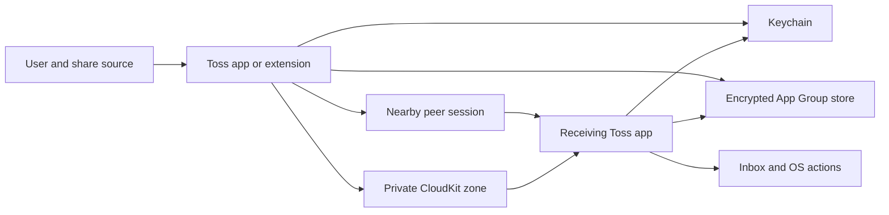

# Toss threat model

## Executive summary

Toss's highest-risk boundary is the transition from untrusted nearby peers or CloudKit records into a trusted device's local inbox. The release candidate uses paired public keys, authenticated encryption, strict content validation, and a durable replay ledger on that path. The most consequential residual risks are private-key theft (which exposes previously captured ciphertext because static agreement keys lack forward secrecy), denial of service or metadata leakage by a compromised iCloud account/server, imperfect cleanup of undelivered assets when no client runs, and unverified real-device behavior under production entitlements.

## Scope and assumptions

Production/runtime code in `Packages/TossCore/Sources/TossCore`, `Apps`, `Extensions`, `Config`, and `project.yml` is in scope. XcodeGen, build commands, and tests are considered only as release controls, not internet-facing runtime services. This model assumes personal devices paired by QR, primarily signed into the **same iCloud account**, as specified in the product brief. The optional user clarification on whether different-account delivery is required had not been answered when this draft was completed; supporting different accounts would require a different CloudKit sharing/identity model and materially change the threat ranking. Devices with a compromised OS or stolen unlocked Keychain are outside the app's cryptographic protection boundary.

## System model

### Primary components

- `TossEngine` is the send/receive coordinator and state machine (`TossEngine.swift`). `PeerTransport` uses Multipeer Connectivity for nearby discovery and bounded wire messages (`Transport.swift`). `CloudTransferTransport` stores encrypted assets in a private CloudKit zone and fetches incremental changes (`CloudTransferTransport.swift`).
- `Security.swift` owns Keychain access, Curve25519 identity, QR/HMAC pairing, HKDF, and AES-GCM envelopes. `Storage.swift` owns encrypted App Group snapshots/blobs and a cross-process lock. `Content.swift` validates inbound content and file types.
- iOS/macOS app entry points (`TossiOSApp.swift`, `TossMacApp.swift`) start sync and handle push hints. Share extensions (`ShareExtensionView.swift`) validate and queue into the same encrypted App Group store.

### Data flows and trust boundaries

- User/other app → share extension or compose UI: user-selected text, URLs, images, files; bounded by `FileSafety` and local classification before persistence. Share providers and file contents are untrusted (`ShareExtensionView.swift`, `Content.swift`).
- App/extension → shared App Group + Keychain: encrypted state and blobs cross a process boundary under App Group entitlement; identity/storage keys are requested from the explicit shared Keychain access group (`Storage.swift`, `Security.swift`, `Config/*.entitlements`).
- Nearby peer → MCSession → `TossEngine.receive`: discovery IDs are routing hints; frames have length limits, trusted-key lookup, AES-GCM authentication, metadata/file validation, and replay checks (`Transport.swift`, `TossEngine.swift`, `Content.swift`). MCSession's peer name itself is not cryptographic identity.
- CloudKit private database → `TossEngine.processCloudRecord`: record fields and assets are untrusted. Receiver filters by recipient, finds a trusted sender key, limits asset reads, opens the authenticated envelope, validates the transfer UUID against the record ID, and commits before acknowledging (`CloudTransferTransport.swift`, `TossEngine.swift`). CloudKit account access is a transport condition, not sender authentication.
- Inbox → OS actions/notifications: checked URLs require a user tap; Calendar/Photos writes require explicit user actions. Notifications omit title/content by default (`TransferViews.swift`, `IncomingNotifier.swift`).

#### Diagram

## Assets and security objectives

| Asset | Why it matters | Objective |
| --- | --- | --- |
| Device private key and storage key | Decrypt transfers and local history; impersonate a device if stolen | Confidentiality, integrity |
| Trusted public-key list | Decides whose transfers and receipts are accepted | Integrity |
| Transfer content and metadata | May contain private text, files, locations, and filenames | Confidentiality, integrity, availability |
| Replay ledger, pending receipts, change token | Prevent duplicate UI items and false delivered states after crashes | Integrity, availability |
| Pairing QR secret | Temporarily authorizes a new device | Confidentiality, integrity |
| CloudKit assets and routing fields | Offline mailbox; reveals size/timing/fingerprints even though content is encrypted | Confidentiality, availability |
| Signed app/extension entitlements | Control access to App Group, Keychain, CloudKit, and push | Integrity, availability |

## Attacker model

### Capabilities

A malicious nearby device can advertise spoofed names/IDs, invite or connect, send malformed frames, withhold receipts, and attempt replay. An attacker with access to the user's private CloudKit zone (compromised Apple account/device or server) can read, delete, delay, reorder, or alter cloud records and observe routing metadata and ciphertext. A malicious share source can provide malformed files/URLs. Someone who sees an active QR can try to pair before it expires.

### Non-capabilities

Without the paired private key, these attackers cannot produce a valid Toss encrypted transfer or receipt for that identity. Without the storage key, modifying the App Group file does not yield a valid encrypted snapshot. The model does not treat an OS-level Keychain compromise as preventable by app code.

## Entry points and attack surfaces

| Surface | How reached | Trust boundary | Notes | Evidence |
| --- | --- | --- | --- | --- |
| QR/manual pairing URL | Camera or explicit paste | External code → trust list | Expiry, HMAC, code comparison prompt; exposed QR is credential | `Security.swift:PairingOffer`, `PairingScannerView.swift` |
| Nearby wire frame | MCSession delegate | Untrusted peer → decoder | Bounded frame, but discoverable ID is spoofable | `Transport.swift:didReceive`, `TossEngine.swift:receive` |
| Cloud asset and fields | Incremental zone fetch | Private database → decoder | Bounded `CKAsset` read, authenticated envelope, record/UUID binding | `CloudTransferTransport.swift:decodeEnvelope`, `TossEngine.swift:processCloudRecord` |
| Share item/file URL | OS share extension | Other app → App Group | Explicit user action; file validation and bounded reads | `ShareExtensionView.swift:ShareExtractor`, `Content.swift:FileSafety` |
| URL/action metadata | Transfer detail | Received item → OS action | Checked schemes and user tap | `Content.swift:IncomingValidator`, `TransferViews.swift` |
| Encrypted local state | App/extension shared container | File system → app state | AES-GCM, lock, atomic write | `Storage.swift:readState`, `Storage.swift:withLock` |
| Push notification | APNs/CloudKit hint | External wakeup → sync | Payload ignored for content; fetches zone changes | `TossiOSApp.swift:TossMobileDelegate`, `TossMacApp.swift:TossMacDelegate` |

## Top abuse paths

1. A nearby attacker copies a trusted discovery ID, keeps an MCSession connected, and drops messages. Application encryption prevents content theft; a five-second missing-receipt timeout switches to CloudKit when available. If iCloud is unavailable, this remains a local availability attack.
2. A cloud-record attacker changes `recipient`, record name, or ciphertext. `decodeEnvelope`, `CryptoBox.open`, and transfer/receipt UUID checks reject it. The attacker can still delete or delay records, causing availability loss.
3. A stolen pairing QR lets someone attempt to join during its five-minute lifetime. HMAC proves possession of the QR secret, so secrecy of the displayed QR matters; the user is prompted to compare a public-key verification code. Already-consumed offers cannot be reused.
4. A sender or cloud attacker replays a valid encrypted transfer through both transports. `Storage.recordIncoming` uses a persistent UUID ledger, so the receiver stores one Inbox item and can issue the same authenticated receipt again.
5. A malformed or oversized cloud asset attempts memory exhaustion or parser abuse. `decodeEnvelope` reads at most 21 MiB plus one byte and `IncomingValidator` applies the 20 MB content cap. Foundation/Media framework decoder vulnerabilities remain an OS dependency.
6. A crafted filename or URL tries path traversal or unsafe URL dispatch. `FileSafety.safeFilename` removes path components, blobs use generated UUID paths, and `IncomingValidator` limits source URLs to HTTP(S). System actions require a tap.
7. A forged acceptance tries to mark a send delivered. `processReceipt` authenticates with the paired key and checks transfer ID, sender/recipient relationship, and accepted flag before changing status.
8. A forgotten device submits old ciphertext. The trusted-key lookup fails, so no new item is accepted; content already decrypted by that device cannot be clawed back.

## Threat model table

| ID | Threat source and prerequisite | Threat action and impact | Controls and evidence | Gap and mitigation | Detection | Likelihood | Impact | Priority |
| --- | --- | --- | --- | --- | --- | --- | --- | --- |
| TM-001 | Nearby spoofing peer can discover service | Hold a false connection and suppress direct delivery | Authenticated envelopes/receipts; five-second fallback (`Security.swift`, `TossEngine.swift`) | Without iCloud, delivery can remain delayed; future direct channel should authenticate the session before treating it as available | Privacy-safe failed-send count | Medium | Medium | Medium |
| TM-002 | CloudKit account/server or device compromised | Read routing/size metadata, delete or delay ciphertext | Private zone, encrypted asset, trusted-key validation (`CloudTransferTransport.swift`, `TossEngine.swift`) | E2EE cannot guarantee availability or hide all traffic metadata; document and test restore/retry | Sync error and age diagnostics, no content logs | Low to medium | High | Medium |
| TM-003 | Captured ciphertext plus later device private-key theft | Decrypt old transfers | This Device Only Keychain and fresh HKDF salt (`Security.swift`) | Static agreement keys lack forward secrecy; plan versioned ephemeral-key protocol and re-pairing/rotation for a later version | Keychain failures and device revocation events | Low | High | Medium |
| TM-004 | Malicious peer/cloud record | Replay or mutate transfer/receipt to duplicate item or forge delivery | AES-GCM AAD, metadata/UUID checks, durable replay ledger (`Security.swift`, `Storage.swift`, `TossEngine.swift`) | Full physical-device crash/retry testing still required | Rejected-record counters without payload | Medium | Medium | Low |
| TM-005 | Malicious share provider or sender | Oversized/malformed image/file causes resource exhaustion or framework decoder issue | 20 MB import/read cap, image/PDF checks, generated paths (`Content.swift`, `ShareExtensionView.swift`) | Peak-memory and fuzz testing needed on oldest devices | Crash/OS memory diagnostics in development | Medium | Medium | Medium |
| TM-006 | Exposed or swapped QR during pairing | Add attacker public key to trust list | One-time 32-byte secret, five-minute expiry, HMAC, visible code comparison (`Security.swift`, `PairingScannerView.swift`) | Confirmation is user-mediated; QR can still be stolen if displayed publicly | Pairing history/device list review | Low to medium | High | Medium |
| TM-007 | Entitlement or upgrade mismatch | Extension creates different identity or cannot read queue | Explicit shared Keychain group, containing-app migration, encrypted App Group (`Security.swift`, `Config/*.entitlements`) | Requires signed app/extension integration testing; do not ship before profiles validated | Startup storage error, diagnostic identity prefix | Medium until verified | High | High |
| TM-008 | No client runs after offline upload | Undelivered ciphertext persists past intended 30 days | Recipient deletes after receipt; sender tracks expiry lease (`TossEngine.swift`, `Storage.swift`) | CloudKit has no configured server TTL; no hard maximum without a server job. Decide whether this retention property is a release requirement | Age of cloud leases on next run | Medium | Low to medium | Medium |
| TM-009 | User chooses content previews | Lock-screen notification reveals title | Generic notification text by default (`IncomingNotifier.swift`, Settings) | Opt-in preview remains user-visible; verify OS notification privacy settings | Manual lock-screen QA | Medium | Medium | Low |

## Criticality calibration

**Critical** would mean remote plaintext exposure or arbitrary code execution on a receiving device without a paired key; no such path is established by this review. **High** includes loss of identity/storage keys across all installs or a signed-entitlement mismatch that permanently breaks transfer/history access (TM-007). **Medium** includes targeted delivery suppression, captured-ciphertext exposure after a later key theft, malformed-file denial of service, or excess cloud retention (TM-001/003/005/008). **Low** includes a one-time generic-notification leak or a replay rejected by the existing ledger (TM-004/009). These rankings assume personal, same-account use and intact Apple OS security.

## Focus paths for security review

| Path | Why it matters | Related IDs |
| --- | --- | --- |
| `Packages/TossCore/Sources/TossCore/Security.swift` | Keychain migration, pairing, long-term keys, and envelope authentication | TM-003, TM-006, TM-007 |
| `Packages/TossCore/Sources/TossCore/TossEngine.swift` | Cross-transport state, receipt semantics, failover, revocation | TM-001, TM-002, TM-004, TM-008 |
| `Packages/TossCore/Sources/TossCore/CloudTransferTransport.swift` | CloudKit staging, bounds, zone tokens, subscription, and record validation | TM-002, TM-004, TM-005 |
| `Packages/TossCore/Sources/TossCore/Storage.swift` | Atomic replay ledger and shared encrypted state | TM-004, TM-007, TM-008 |
| `Packages/TossCore/Sources/TossCore/Transport.swift` | Unauthenticated discovery labels and frame limits | TM-001, TM-005 |
| `Packages/TossCore/Sources/TossCore/Content.swift` | File/URL validation and decompression risk | TM-005 |
| `Extensions/Shared/ShareExtensionView.swift` | Untrusted share input and queue handoff | TM-005, TM-007 |
| `Config/Toss-iOS.entitlements`, `Config/Toss-macOS.entitlements` | Shared access and CloudKit/notification provisioning | TM-007 |

## Quality check and open questions

All discovered runtime input surfaces and trust boundaries above are represented in the table; CI/dev tools are separated from runtime. The same-account assumption remains to be confirmed. Physical signed-device tests, production CloudKit schema deployment, APNs behavior, and independent review are outstanding; this document is not a proof of absence of vulnerabilities.
